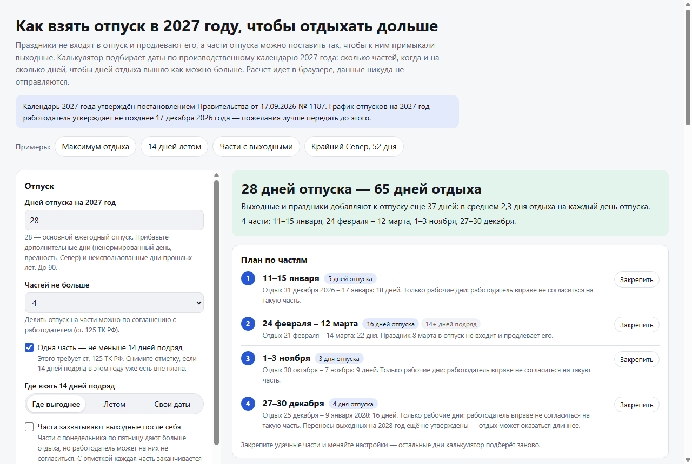

# Как взять отпуск в 2027 году, чтобы отдыхать дольше

[](https://github.com/kireev-duty/vygodnyy-otpusk/actions/workflows/tests.yml)
[](LICENSE)

**[Открыть калькулятор →](https://kireev-duty.github.io/vygodnyy-otpusk/)**

Нерабочие праздники не входят в отпуск и продлевают его, а части отпуска можно поставить так, чтобы к ним примыкали выходные. Так 4 дня отпуска с 4 по 7 мая 2027 года дают 10 дней отдыха, а 4 дня с 27 по 30 декабря — 16 дней, до 9 января 2028 года. Статьи «как выгодно взять отпуск» перечисляют такие окна, но не собирают из них план на весь год с учётом правила 14 дней и ваших ограничений.

Калькулятор подбирает даты по производственному календарю 2027 года: на сколько частей разделить отпуск, когда брать каждую часть и на сколько дней, чтобы получить как можно больше дней отдыха. При настройках по умолчанию 28 дней отпуска дают 65 дней отдыха.



## Что умеет

- **План по частям**: даты каждой части, сколько дней отпуска в ней, какой отдых получится вместе с выходными и праздниками. Ровно столько дней, сколько у вас есть.
- **Правило 14 дней**: одна часть — не меньше 14 календарных дней. Можно задать, где она должна быть: летом или в своих датах.
- **Закреплённые даты**: отметьте части, которые уже решены, — остальные дни калькулятор распределит вокруг них.
- **Ограничения**: периоды, когда уйти нельзя, период планирования (если выходите на работу не с января), предел числа частей.
- **Части с выходными**: режим для работодателей, которые не соглашаются на части «с понедельника по пятницу».
- **Праздники региона**: нерабочие праздники Татарстана, Башкортостана и других регионов тоже не входят в отпуск.
- **Длинные выходные 2027 года** с готовыми вариантами продления, которые одним нажатием добавляются в план.
- **Деньги**: если указать оклад, калькулятор покажет отпускные и зарплату, которую не начислят за рабочие дни отпуска, и сравнит план с вариантом «части с выходными».
- **Календарь на год**, в котором даты отмечаются щелчком; текст заявления, файл .ics для календаря, ссылка с данными и печать в PDF.

Калькулятор — один HTML-файл без внешних библиотек. Он работает в браузере на компьютере и телефоне, в том числе без интернета. Введённые данные никуда не отправляются.

## Какие правила заложены

| Правило | Значение |
| --- | --- |
| Нерабочие праздники | 1–8 января, 23 февраля, 8 марта, 1 и 9 мая, 12 июня, 4 ноября (ст. 112 ТК РФ) |
| Праздники в отпуске | в число дней отпуска не входят, отпуск продлевается (ст. 120 ТК РФ) |
| Выходные в отпуске | входят, отпуск считается в календарных днях (ст. 115, 120 ТК РФ) |
| Перенесённые выходные 2027 года | 22 февраля, 3 и 10 мая, 14 июня, 5 ноября, 31 декабря — входят в отпуск как обычные выходные |
| Рабочая суббота 2027 года | 20 февраля |
| Стык лет | 31 декабря 2026 года — выходной; 1–8 января 2028 года — праздники, переносы на 2028 год ещё не утверждены |
| Деление на части | по соглашению с работодателем, одна часть — не меньше 14 календарных дней (ст. 125 ТК РФ) |
| Части только из рабочих дней | допустимы, если работодатель согласен (позиция Роструда) |
| Отпуск только на выходные | не допускается: в каждой части есть хотя бы один рабочий день |
| График отпусков | утверждается не позднее чем за две недели до нового года, то есть до 17 декабря 2026 года (ст. 123 ТК РФ) |
| Отпускные | средний дневной заработок = заработок за 12 месяцев / 12 / 29,3 (ст. 139 ТК РФ, Положение № 922) |

**Источники:** Трудовой кодекс РФ (ст. 112, 115, 120, 123, 125, 136, 139); [постановление Правительства РФ от 17.09.2026 № 1187 «О переносе выходных дней в 2027 году»](https://www.garant.ru/hotlaw/federal/2245207/); [производственный календарь на 2027 год (КонсультантПлюс)](https://www.consultant.ru/law/ref/calendar/proizvodstvennye/2027/); постановление Правительства РФ от 24.09.2025 № 1466 «О переносе выходных дней в 2026 году» (выходной 31 декабря 2026 года); постановление Правительства РФ от 24.12.2007 № 922 (расчёт среднего заработка); [подборка «Можно ли брать отпуск только в рабочие дни» (КонсультантПлюс)](https://www.consultant.ru/law/podborki/mozhno_li_brat_otpusk_tolko_v_rabochie_dni/).

## Как ищется лучший план

Дни отдыха — это все нерабочие дни в непрерывных блоках, куда попал хотя бы один день отпуска. Калькулятор ищет план с наибольшим числом таких дней, где потрачены ровно все дни отпуска, частей не больше заданного и, если правило включено, есть часть из 14 дней и больше в нужном периоде. При равном отдыхе выбирается план с меньшим числом частей.

Поиск идёт динамическим программированием по дням года. Состояние: идёт ли часть отпуска и сколько в ней уже дней (до 14), продолжается ли блок отдыха после прошлой части, сколько частей закончено, есть ли уже длинная часть и сколько дней потрачено. Выходные перед частью засчитываются в момент её начала, после части — пока не наступит рабочий день. Так находится точный оптимум, а не приближение: 90 дней и 8 частей считаются меньше чем за полсекунды.

Тесты сравнивают результат с полным перебором на 300 случайных задачах с запретами, закреплёнными частями, праздниками региона и окном для длинной части. Найденный план ни разу не хуже перебора, а его счёт совпадает с независимым пересчётом по календарю.

## Допущения модели

- Пятидневная рабочая неделя. Шестидневка и сменный график не поддерживаются.
- Свободные части начинаются в рабочий день и не заканчиваются праздником: иначе отпускной день тратится без пользы. Закреплённые части могут быть любыми.
- Части не идут подряд: между ними есть хотя бы один день.
- В режиме «части с выходными» после каждой части сразу идёт рабочий день, то есть выходные в конце части входят в отпуск.
- В расчёте денег оклад считается неизменным последние 12 месяцев, без премий и больничных. Суммы до вычета НДФЛ.
- Праздники региона нужно отметить самостоятельно: у мусульманских праздников даты в 2027 году определяются отдельно.

Расчёт ориентировочный и не заменяет консультацию юриста или кадровика. Календарь и правила актуальны на октябрь 2026 года.

## Как запустить у себя

Скачайте `index.html` и откройте его в браузере. Больше ничего не нужно.

Чтобы выложить свою копию в интернет, сделайте форк репозитория и включите GitHub Pages: Settings → Pages → Branch: `main`, папка `/ (root)`.

## Как обновить календарь

Праздники и переносы выходных лежат в `index.html` внутри `<script id="core">`: список `HOLIDAYS` и объект `CAL`, где для каждого года перечислены будни, ставшие выходными (`off`), и выходные, ставшие рабочими (`work`). Чтобы добавить 2028 год, допишите в `CAL` переносы из постановления Правительства и поменяйте год `Y` в интерфейсе.

Расчётное ядро — чистые функции без доступа к странице, поэтому его удобно проверять тестами:

```bash
node tests.mjs
```

Нужен Node.js 18 или новее. Тесты сверяют календарь с производственным (247 рабочих дней в 2027 году и число рабочих дней по месяцам), проверяют подсчёт дней отпуска и отдыха, закреплённые части, запреты, режим «с выходными», окно для длинной части, ошибки ввода, расчёт денег и сравнивают оптимизатор с полным перебором. Они запускаются автоматически при каждом изменении в репозитории.

Нашли ошибку в расчёте или устаревшее правило? [Создайте issue](https://github.com/kireev-duty/vygodnyy-otpusk/issues).

## Лицензия

[MIT](LICENSE) — можно свободно использовать, менять и распространять.
